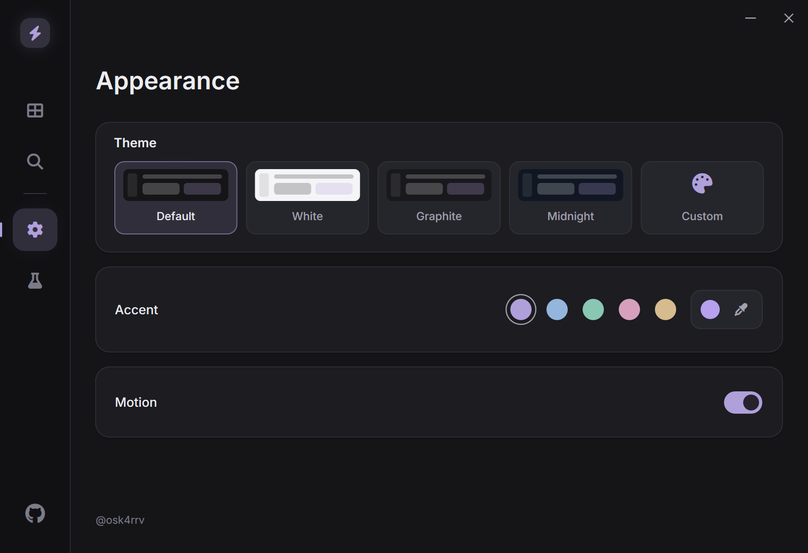

# Quest Completer

Native C++17 app for Windows 10/11. Browse game metadata, run Standard or Discord RPC sessions, and inspect detection details.



## Download

Get `QuestCompleter-Windows-x64.zip` from [Releases](https://github.com/osk4rrv/discord-quest-completer/releases), extract it and run `QuestCompleter.exe`.

## What's included

- Steam, Epic and Discord search, with pages of 100 and a Standard filter.
- 55 sourced executable folder profiles, plus additional path resolution.
- Owned helper processes with Stop, cleanup and recovery checks.
- RPC acknowledgements, reconnect handling and diagnostics in Info.
- Separate theme and accent palettes, custom colors and DPI-aware rendering.

The catalog lists detectable applications. It does not list the Quests available on your account.

## Before using it

Session timers count local runtime. An RPC acknowledgement means Discord accepted an activity. Neither confirms Quest credit; check progress and claim rewards in Discord.

**FC 27 is experimental.** The latest five-minute Standard test after a full Discord restart still showed **0%**. Its folder profile comes from community reports, not a verified fix.

Select a game, open Info, choose Standard or RPC, then start the session. Stop it from Dashboard or the session window. Closing the app stops its helpers. Only one RPC session can run at a time.

FC 27 can create a temporary helper and manifest in a registered Steam library. Existing game files are preserved. Without a usable library, it uses a local helper folder.

## Build

Requires CMake 3.24+, Visual Studio 2022 / Build Tools with **Desktop development with C++**, and the Windows SDK.

```powershell
.\scripts\build.ps1
```

Builds x64 Release, runs four CTest checks and creates `dist/QuestCompleter-Windows-x64.zip`. Add `-Run` to launch it. GitHub Actions builds pushes and pull requests; version tags publish releases.

## Data and sources

Preferences, caches and reports live in `%LOCALAPPDATA%\QuestCompleter`. The app does not read account tokens, patch Discord or call private Quest heartbeat endpoints. External catalogs can change or fail.

[Metadata sources and test results](docs/data-sources.md) · [Development](CONTRIBUTING.md) · [Changelog](CHANGELOG.md)

## License

[MIT](LICENSE). Bundled fonts and JSON keep their [own licenses](THIRD_PARTY_NOTICES.md).
